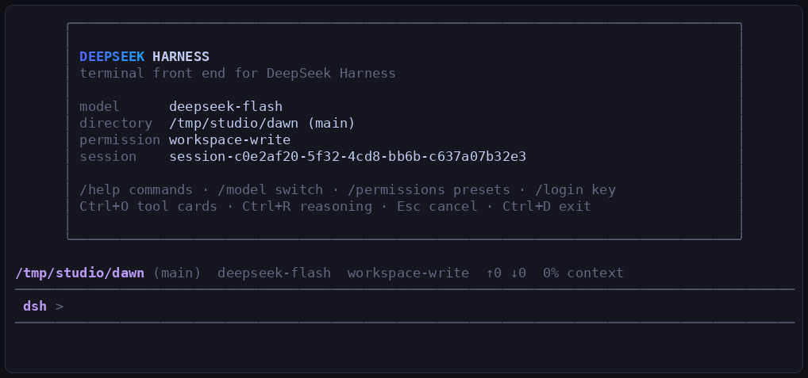
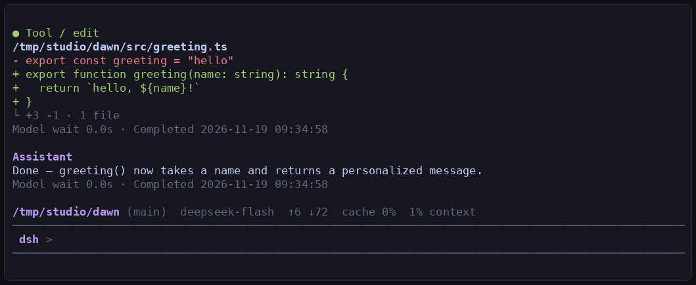
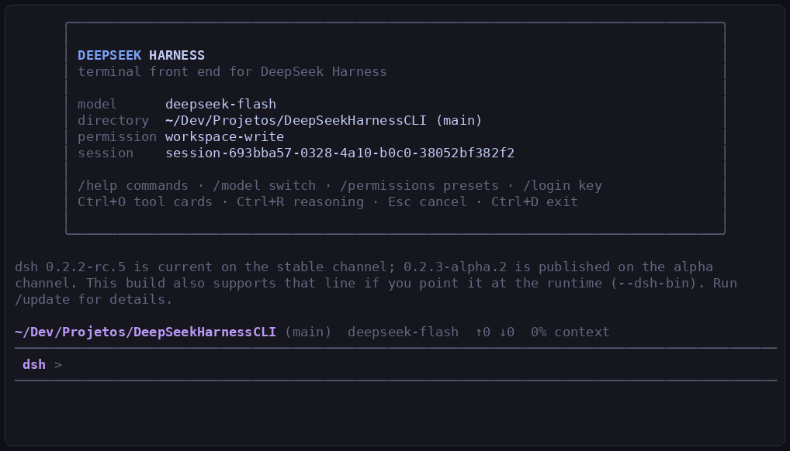

# dsh-tui — DeepSeek Harness in your terminal

**English** · [Português](README.md)

[](https://www.npmjs.com/package/@gblelis/dsh-tui)
[](https://github.com/gblelis/dsh-tui/actions/workflows/ci.yml)

[](LICENSE)

A **TUI** (Text User Interface) front end for [DeepSeek Harness](https://github.com/deepseek-ai/deepseek-harness).
The official DSH ships Desktop and Web only; the Web app needs an HTTP server, which gets in the way when
you work from another machine (network/DeepSeek restrictions). `dsh-tui` runs the **same DSH core** — same
agents, same tools, same session format — straight in your terminal, with no server and no browser.







- **One binary**, one command: `dsh-tui`.
- **Shared core**: the CLI does not reimplement DSH. It installs a *profile* that loads
  `@deepseek-ai/dsh-base` and adds only the terminal layer.
- **Compatible by construction**: the bundle declares `engines.dsh` and compiles against DSH's public API;
  upgrading DSH is upgrading a dependency, not rewriting the project.
- **Knows when upstream moved**: if npm publishes a newer dsh than this build, the TUI says so itself
  (`/update` shows the numbers).
- **Auditable**: [docs/seguranca.md](docs/seguranca.md) carries the threat model, the hardening and the
  reachability analysis of the runtime's transitive advisories.

> The deep-dive documents under `docs/` are written in Brazilian Portuguese; this README covers the
> essentials in English, and the code, CLI help and `doctor` output are in English.

---

## Current state (v0.2.1)

| Area | Status |
| --- | --- |
| Profile boot + launcher (`install`, `sync`, `doctor`, `profile`, `runtime`, `version`, `print`) | ✅ verified |
| Full chat: streaming, transcript, tool cards, diffs, reasoning, per-phase timing | ✅ ported |
| Startup screen: panel with model, directory/branch, permission preset, session and shortcuts; double-rule composer | ✅ |
| Commands `help`, `model`, `clear`, `details`, `palette`, `reload`, `resume`, `status`, `update`, `export`, `permissions`, `login`, `exit`/`quit` | ✅ |
| Sessions: new, `--continue`, `--resume [id]`, `--session-id`, `/resume` | ✅ |
| Model and reasoning-effort selection (`/model`, `--model`, `--reasoning-effort`) | ✅ |
| `--permission-mode`, in-session `/permissions`, `ask_user_question`, `@session` references | ✅ |
| Scheduling (`schedule_*`), per-subagent model, date/time in context, `/skill:dsh-doc` skill | ✅ |
| DSH release awareness: `/update`, the `dsh release` row in `doctor`, and a transcript notice when the pin trails | ✅ |
| `/export [path]` (Markdown), `/login` (masked key), MCP through `dsh-mcp-client` | ✅ |
| Unit tests for the pure parts (launcher, tokens, timing, prompt, config) | ✅ |
| Screen smoke: real boot + rendering checked in xterm (headless) | ✅ `pnpm smoke:screen` |
| Chat smoke: prompt, stream, real tool card (bash), `/export`, `/permissions`, `/login` and resume | ✅ `pnpm smoke:chat` |
| Install smoke: `npm pack` → `npm install -g` → boot of the installed binary | ✅ `pnpm smoke:install` |
| Real PTY in CI plus tool-card and diff-renderer tests | ✅ |
| Golden screens for dialogs and diffs (versioned snapshots, refresh with `vitest -u`) | ✅ |

The profile was composed and validated against `dsh 0.2.2-rc.5` (`--dump-config`), and the real boot is
exercised end to end by two smokes: the bundle knows how to record what the TUI would write
(`DSH_TUI_CAPTURE_OUTPUT`, a documented test hook) and `pnpm smoke:screen` checks the rendered screen in a
virtual terminal; `pnpm smoke:chat` goes further and actually talks — it types a prompt key by key against
a local Messages-compatible model server and checks the transcript for the user message, the assistant
stream, the context cards and a clean exit. The development sandbox has no PTY, so real-terminal tests live
in CI/on your machine.

---

## Install

Requirements: **Node.js ≥ 24.9** (the same floor as DSH) and a real terminal (stdin and stdout TTYs).

```bash
npm install -g @gblelis/dsh-tui
# or, without installing:
npx @gblelis/dsh-tui@latest
```

The `0.2.1` tarball ships with a signed **provenance** attestation (SLSA v1), visible on
`https://www.npmjs.com/package/@gblelis/dsh-tui`.

From source instead:

```bash
git clone https://github.com/gblelis/dsh-tui.git
cd dsh-tui
corepack enable && pnpm install
pnpm build
cd packages/cli && npm pack            # produces gblelis-dsh-tui-0.2.1.tgz
npm install -g ./gblelis-dsh-tui-0.2.1.tgz
```

The binary already depends on `@deepseek-ai/dsh@0.2.2-rc.5`, so the runtime comes along.

### Where things live

`dsh-tui` does not invent a new directory: it uses DSH's **`DSH_HOME`** (default `~/.dsh`) and creates only
the `tui` profile:

```
$DSH_HOME/
  profiles/tui/
    package.json          # dsh.profile.bundles = [dsh-base, @gblelis/dsh-tui-bundle]
    cordis.patch.yml      # your patch layer (never overwritten)
    pnpm-workspace.yaml
    node_modules/@gblelis/dsh-tui-bundle/   # copy embedded in the CLI package
    .dsh-tui/stamp.json   # hash of the installed copy (self-healing on every boot)
  sessions/               # the SAME sessions as Desktop/Web
  .credentials.yaml
```

Because the bundle is copied from the CLI package itself (rather than installed by `pnpm`/`npm` inside
`DSH_HOME`), the first boot needs neither the network nor a package manager.

---

## First run

```bash
dsh-tui                    # new session
dsh-tui --continue         # continue this directory's newest session
dsh-tui --resume <id>      # resume a specific session
dsh-tui --model deepseek-official/deepseek-v4-pro --reasoning-effort high
dsh-tui --permission-mode read-only
dsh-tui --no-welcome       # skip the welcome panel (compact header)
dsh-tui --no-update-check  # do not look up published DSH releases
dsh-tui doctor             # diagnose Node, profile, runtime and credentials
```

### Credentials

DSH resolves credentials in this order: environment variable, the project `.env`, the home `.env`, then
`$DSH_HOME/.credentials.yaml`. The shortest path:

```bash
export DEEPSEEK_API_KEY=sk-...
dsh-tui
```

If you already set up Desktop/Web, `.credentials.yaml` exists and `dsh-tui` uses the same account.
`dsh-tui doctor` reports which source it found.

### Other providers

Besides the official DeepSeek route, the terminal profile can declare any provider supported by DSH's
multi-provider adapter (`llm-pi-ai`): OpenRouter, OpenAI, Anthropic, LiteLLM, OpenAI-compatible gateways,
Ollama/vLLM and the like. Configuration lives in your patch layer
(`$DSH_HOME/profiles/tui/cordis.patch.yml`), credentials stay in `.credentials.yaml`/the environment, and
the models start showing up in `/model`. If the provider is already configured on the Web **Models** page,
you can copy the `llm-pi-ai` block from `profiles/web` to `profiles/tui`. Recipes and examples in
[docs/providers.md](docs/providers.md).

---

## Keys

| Key | Action |
| --- | --- |
| `Enter` | send the prompt |
| `Esc` | cancel the running turn |
| `Ctrl+C` | with a turn running, cancels; on an empty editor, clears it; twice in a row exits |
| `Ctrl+D` | exit when idle |
| `Ctrl+O` | cycle tool-card visibility |
| `Ctrl+R` | toggle the model's reasoning display |
| `Ctrl+L` | invalidate the render cache and redraw |
| `↑` / `↓` | editor history |
| `Tab` | command, file and reference autocomplete |
| `Shift+Enter` / `Alt+Enter` | newline without sending (when the terminal supports it) |

`/palette` shows what each color means. `/help` lists every shortcut.

---

## Commands

| Command | What it does |
| --- | --- |
| `/help` | shortcuts, commands and tips |
| `/model [provider/]model` | switch this session's model |
| `/clear` | clear the screen (session history is unchanged) |
| `/details [collapsed\|expanded\|hidden] [reasoning on\|off]` | control tool cards and reasoning |
| `/status` | session diagnostics, system prompt and tools |
| `/update` | check published dsh releases and whether this build is behind |
| `/resume` | list resumable sessions from this directory |
| `/export [path]` | write the session as a Markdown transcript |
| `/permissions [preset]` | show or switch the permission preset |
| `/login` | store an API key through the credentials service (masked prompt) |
| `/palette` | show every color and attribute role |
| `/reload` | (experimental) re-read the loader configuration |
| `/exit`, `/quit` | exit after the running turn |

Extra commands come from DSH itself (`ctx.commands`), so the `Tab` menu also lists the core ones.
`/skill:<name>` invokes a skill mid-conversation.

---

## How it works

```
dsh-tui (npm package)                    $DSH_HOME/profiles/tui
┌──────────────────────────────┐         ┌──────────────────────────────────────┐
│ lib/bin.js   launcher        │ writes  │ package.json  (bundles)              │
│   1. resolve DSH_HOME        │ ──────▶ │ cordis.patch.yml (your layer)        │
│   2. validate Node/runtime   │         │ node_modules/@gblelis/dsh-tui-bundle │
│   3. install/repair profile  │         │   ├─ package.json  (dsh.bundle)      │
│   4. exec: node dsh/bin.js   │         │   ├─ cordis.patch.yml                │
│      --profile tui "$@"      │         │   └─ lib/{index,startup,prompt}.js   │
└──────────────────────────────┘         └──────────────────────────────────────┘
                                                    │ loaded by DSH
                                                    ▼
                                  @deepseek-ai/dsh-base (the same core as Web/Desktop)
                                  + tui-startup  (flags → typed values)
                                  + tui-prompt   (prompt interpolation)
                                  + tui          (the TUI itself)
```

The decisions that keep it compatible:

1. **Zero `@deepseek-ai/*` packages inside the bundle.** Everything is a peer/import resolved by the DSH
   installation, so there is a single copy of the core (same `Context`, same sessions).
2. **Only the terminal layer is ours.** The rest of the behavior (tools, permissions, compaction,
   providers) comes from `dsh-base` and keeps evolving with upstream.
3. **`engines.dsh` + launcher range.** The launcher refuses to boot a DSH outside
   `^0.2.2-rc.5 || ^0.2.3-alpha.2` instead of composing half a tree; the bundle would reach the same
   verdict in DSH.
4. **Sessions are DSH files.** Format V4, written by the core: what you start in the terminal can be
   resumed in Desktop/Web (and the other way around).

Details: [architecture](docs/arquitetura.md) · [compatibility](docs/compatibilidade.md) ·
[parity](docs/paridade.md) · [security](docs/seguranca.md) · [release](docs/publicacao.md) ·
[porting/PROVENANCE](docs/porting/PROVENANCE.md).

---

## Development

```bash
pnpm install          # workspace: packages/bundle (private) + packages/cli (published)
pnpm typecheck
pnpm lint
pnpm test             # vitest (unit)
pnpm build            # bundle → lib/, CLI → lib/ + embedded bundle/
pnpm check            # typecheck + lint + test
pnpm verify:package   # tarball contents, bundle hash and version coherence
```

Layout:

| Path | Role |
| --- | --- |
| `packages/bundle/` | the Cordis *bundle* (private, never published): TUI, startup, prompt-service, patch |
| `packages/cli/` | the published package `@gblelis/dsh-tui`: launcher + embedded bundle artifact |
| `patches/` | the `@earendil-works/pi-tui` patch (frameless frame, custom prompt, word wrap) |
| `docs/` | architecture, install, compatibility, parity, security, release, keybindings, troubleshooting |
| `upstream/` | DSH checkout at tag `dsh-v0.2.2-rc.5` (submodule, reference only) |

After changing the bundle: `pnpm --filter @gblelis/dsh-tui-bundle build && pnpm --filter @gblelis/dsh-tui build`.
The second step re-embeds the artifact and recomputes the hash (`bundle/manifest.json`); the launcher
compares that hash with the profile stamp and reinstalls by itself.

Do not edit `packages/cli/bundle/` or `packages/*/lib/` by hand: they are build outputs.

Architecture rules, common tasks (new command, new plugin, goldens, bumping the target dsh) and the PR
checklist are in [CONTRIBUTING.md](CONTRIBUTING.md).

---

## Release

1. `npm login` (an account with access to the `@gblelis` scope; adjust `name` if you publish elsewhere).
2. `pnpm release:build` → runs the build plus `verify:package`.
3. `npm publish --access public` inside `packages/cli`.
4. Tag `vX.Y.Z` triggers the release workflow (build, verification and `npm publish` with `NPM_TOKEN`).

The published package contains only `lib/`, `bundle/`, `LICENSE`, `NOTICE.md` and `README.md`.

---

## License and provenance

This project: MIT. DSH itself is MIT as well.

The TUI code is a port of DeepSeek Harness's first-party terminal front end (the `@deepseek-ai/dsh-tui`
package, removed upstream in commit `10bb9cbf4a`, recovered from `7248b5ec8f`), which declared
**BSD-3-Clause**. That material remains attributed under BSD-3-Clause — a permissive license compatible
with this repository's MIT. File-by-file map, authors and commits:
[docs/porting/PROVENANCE.md](docs/porting/PROVENANCE.md) and [NOTICE.md](NOTICE.md).
