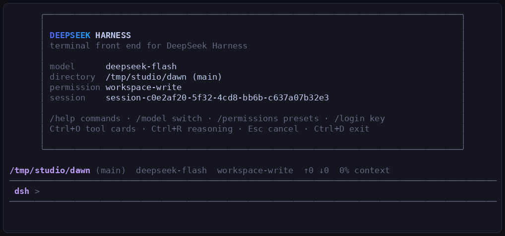
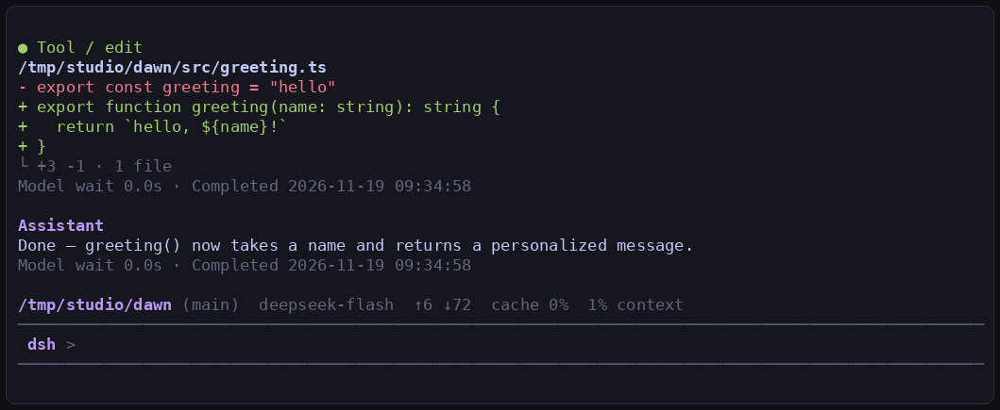
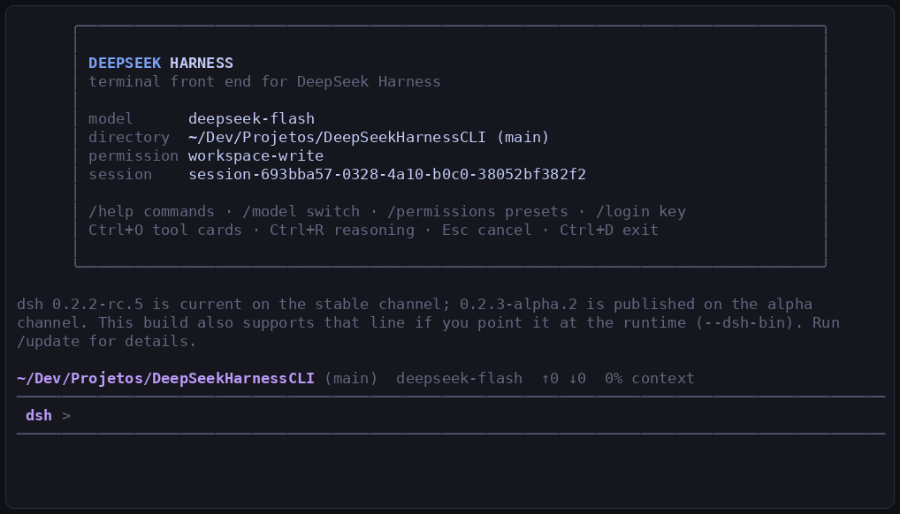

# dsh-tui — DeepSeek Harness no terminal

**Português** · [English](README.en.md)

[](https://www.npmjs.com/package/@gblelis/dsh-tui)
[](https://github.com/gblelis/dsh-tui/actions/workflows/ci.yml)

[](LICENSE)

Front end **TUI** (Text User Interface) para o [DeepSeek Harness](https://github.com/deepseek-ai/deepseek-harness).
O DSH oficial só oferece Desktop e Web; o Web depende de um servidor HTTP, o que atrapalha acesso de outra
máquina (bloqueios de rede/DeepSeek). O `dsh-tui` roda o **mesmo core** do DSH — mesmos agentes, mesmas
ferramentas, mesmo formato de sessão — direto no seu terminal, sem servidor e sem navegador.







- **Um binário**, um comando: `dsh-tui`.
- **Core compartilhado**: o CLI não reimplementa o DSH. Ele instala um *profile* que carrega o
  `@deepseek-ai/dsh-base` e adiciona apenas a camada de terminal.
- **Compatível por construção**: o bundle declara `engines.dsh` e compila contra a API pública do DSH;
  atualizar o DSH é atualizar uma dependência, não reescrever o projeto.
- **Sabe quando o upstream andou**: se o npm publicar um dsh mais novo que a build, a própria TUI avisa
  (e `/update` mostra os números).
- **Auditável**: [docs/seguranca.md](docs/seguranca.md) traz o modelo de ameaça, os endurecimentos e a
  análise de alcance dos advisories transitivos do runtime.

---

## Estado atual (v0.2.1)

| Área | Situação |
| --- | --- |
| Boot do profile + launcher (`install`, `sync`, `doctor`, `profile`, `runtime`, `version`, `print`) | ✅ verificado |
| Chat completo: streaming, transcript, tool cards, diffs, raciocínio, timing por fase | ✅ portado |
| Tela inicial: painel com modelo, diretório/branch, preset de permissão, sessão e atalhos; composer com régua dupla | ✅ |
| Comandos `help`, `model`, `clear`, `details`, `palette`, `reload`, `resume`, `status`, `update`, `export`, `permissions`, `login`, `exit`/`quit` | ✅ |
| Sessões: nova, `--continue`, `--resume [id]`, `--session-id`, `/resume` | ✅ |
| Seleção de modelo e esforço de raciocínio (`/model`, `--model`, `--reasoning-effort`) | ✅ |
| `--permission-mode`, `/permissions` em sessão, `ask_user_question`, referências `@sessão` | ✅ |
| Agendamento (`schedule_*`), modelo por subagente, data/hora no contexto, skill `/skill:dsh-doc` | ✅ |
| Aviso de release do DSH: `/update`, linha `dsh release` no `doctor` e alerta no transcript quando o pin está atrás | ✅ |
| `/export [caminho]` (Markdown), `/login` (chave mascarada), MCP via `dsh-mcp-client` | ✅ |
| Testes unitários das partes puras (launcher, tokens, timing, prompt, config) | ✅ |
| Smoke de tela: boot real + renderização conferida no xterm (headless) | ✅ `pnpm smoke:screen` |
| Smoke de conversa: prompt, stream, tool card real (bash), `/export`, `/permissions`, `/login` e retomada | ✅ `pnpm smoke:chat` |
| Smoke de instalação: `npm pack` → `npm install -g` → boot do binário instalado | ✅ `pnpm smoke:install` |
| PTY real no CI e testes do tool card e do renderizador de diffs | ✅ |
| Golden screens de diálogos e diffs (snapshots versionados, `vitest -u` atualiza) | ✅ |

O profile foi composto e validado com `dsh 0.2.2-rc.5` (`--dump-config`), e o boot real é exercitado de
ponta a ponta por dois smokes: o bundle sabe gravar o que a TUI escreveria (`DSH_TUI_CAPTURE_OUTPUT`,
documentado como hook de teste) e `pnpm smoke:screen` confere a tela renderizada num terminal virtual;
`pnpm smoke:chat` vai além e conversa — digita um prompt tecla por tecla contra um servidor de modelos
local compatível com Messages e confere no transcript a mensagem do usuário, o stream do assistente, os
cards de contexto e a saída limpa. O ambiente de desenvolvimento não tem PTY, então testes com terminal de
verdade ficam no CI/na sua máquina.

---

## Instalação

Requisitos: **Node.js ≥ 24.9** (mesmo piso do DSH) e um terminal de verdade (stdin e stdout TTY).

```bash
npm install -g @gblelis/dsh-tui
# ou, sem instalar:
npx @gblelis/dsh-tui@latest
```

A `0.2.1` saiu com **provenance** assinada (SLSA v1) — dá para conferir em
`https://www.npmjs.com/package/@gblelis/dsh-tui`.

Alternativa a partir do código:

```bash
git clone https://github.com/gblelis/dsh-tui.git
cd dsh-tui
corepack enable && pnpm install
pnpm build
cd packages/cli && npm pack            # gera gblelis-dsh-tui-0.2.1.tgz
npm install -g ./gblelis-dsh-tui-0.2.1.tgz
```

O binário já declara `@deepseek-ai/dsh@0.2.2-rc.5` como dependência, então o runtime vem junto.

### Onde as coisas ficam

O `dsh-tui` não inventa um diretório novo: ele usa o **`DSH_HOME`** do DSH (padrão `~/.dsh`) e cria
apenas o profile `tui`:

```
$DSH_HOME/
  profiles/tui/
    package.json          # dsh.profile.bundles = [dsh-base, @gblelis/dsh-tui-bundle]
    cordis.patch.yml      # sua camada de patches (nunca é sobrescrita)
    pnpm-workspace.yaml
    node_modules/@gblelis/dsh-tui-bundle/   # cópia embutida no pacote CLI
    .dsh-tui/stamp.json   # hash da cópia instalada (auto-reparo a cada boot)
  sessions/               # as MESMAS sessões do Desktop/Web
  .credentials.yaml
```

Como o bundle é copiado do próprio pacote (e não instalado por `pnpm`/`npm` dentro do `DSH_HOME`), o
primeiro boot não depende de rede nem de package manager.

---

## Primeiro uso

```bash
dsh-tui                    # sessão nova
dsh-tui --continue         # continua a sessão mais recente deste diretório
dsh-tui --resume <id>      # retoma uma sessão específica
dsh-tui --model deepseek-official/deepseek-v4-pro --reasoning-effort high
dsh-tui --permission-mode read-only
dsh-tui --no-welcome       # pula o painel de boas-vindas (cabeçalho compacto)
dsh-tui --no-update-check  # não consulta releases publicadas do DSH
dsh-tui doctor             # diagnóstico de Node, profile, runtime e credenciais
```

### Credenciais

O DSH resolve credenciais nesta ordem: variável de ambiente, `.env` do projeto, `.env` do home,
depois `$DSH_HOME/.credentials.yaml`. O caminho mais simples:

```bash
export DEEPSEEK_API_KEY=sk-...
dsh-tui
```

Se você já configurou o Desktop/Web, o arquivo `.credentials.yaml` já existe e o `dsh-tui` usa a mesma
conta. `dsh-tui doctor` mostra qual fonte foi encontrada.

### Outros providers

Além da rota oficial da DeepSeek, o profile do terminal pode declarar qualquer provider do adaptador
multi-provider do DSH (`llm-pi-ai`): OpenRouter, OpenAI, Anthropic, LiteLLM, gateways OpenAI-compatible,
Ollama/vLLM e afins. A configuração fica na sua camada de patch
(`$DSH_HOME/profiles/tui/cordis.patch.yml`), as credenciais continuam no `.credentials.yaml`/ambiente e os
modelos passam a aparecer em `/model`. Se o provider já está configurado na página **Models** do Web, dá
para copiar o bloco `llm-pi-ai` de `profiles/web` para `profiles/tui`. Receitas e exemplos em
[providers.md](docs/providers.md).

---

## Teclas

| Tecla | Ação |
| --- | --- |
| `Enter` | envia o prompt |
| `Esc` | cancela o turno em andamento |
| `Ctrl+C` | com turno ativo cancela; vazio limpa o editor; duas vezes seguidas sai |
| `Ctrl+D` | sai quando ocioso |
| `Ctrl+O` | alterna a visibilidade dos cards de ferramenta |
| `Ctrl+R` | alterna a exibição do raciocínio do modelo |
| `Ctrl+L` | invalida o cache de renderização e redesenha |
| `↑` / `↓` | histórico do editor |
| `Tab` | autocomplete de comandos, arquivos e referências |
| `Shift+Enter` / `Alt+Enter` | nova linha sem enviar (quando o terminal suporta) |

A paleta mostra o papel de cada cor: `/palette`. Todos os atalhos: `/help`.

---

## Comandos

| Comando | Para quê |
| --- | --- |
| `/help` | atalhos, comandos e dicas |
| `/model [provider/]model` | troca o modelo da sessão |
| `/clear` | limpa a tela (o histórico da sessão permanece) |
| `/details [collapsed\|expanded\|hidden] [reasoning on\|off]` | controla cards de ferramenta e raciocínio |
| `/status` | diagnósticos da sessão, prompt de sistema e ferramentas |
| `/update` | consulta as releases publicadas do dsh e diz se esta build está atrás |
| `/resume` | lista sessões retomáveis deste diretório |
| `/export [caminho]` | grava a sessão como transcript Markdown |
| `/permissions [preset]` | mostra ou troca o preset de permissão |
| `/login` | guarda uma API key no serviço de credenciais (prompt mascarado) |
| `/palette` | mostra todas as cores/atributos usados |
| `/reload` | (experimental) recarrega a configuração do loader |
| `/exit`, `/quit` | sai após o turno atual |

Comandos extras vêm do próprio DSH (`ctx.commands`), então o menu `Tab` mostra também os do core.
`/skill:<nome>` invoca uma skill no meio da conversa.

---

## Como funciona

```
dsh-tui (pacote npm)                      $DSH_HOME/profiles/tui
┌──────────────────────────────┐          ┌──────────────────────────────────────┐
│ lib/bin.js   launcher        │  escreve │ package.json  (bundles)              │
│   1. resolve DSH_HOME        │ ───────▶ │ cordis.patch.yml (sua camada)        │
│   2. valida Node/runtime     │          │ node_modules/@gblelis/dsh-tui-bundle │
│   3. instala/repara profile  │          │   ├─ package.json  (dsh.bundle)      │
│   4. exec: node dsh/bin.js   │          │   ├─ cordis.patch.yml                │
│      --profile tui "$@"      │          │   └─ lib/{index,startup,prompt}.js   │
└──────────────────────────────┘          └──────────────────────────────────────┘
                                                     │ carregado pelo DSH
                                                     ▼
                                   @deepseek-ai/dsh-base (mesmo core do Web/Desktop)
                                   + tui-startup  (flags → valores tipados)
                                   + tui-prompt   (interpolação do prompt)
                                   + tui          (a TUI em si)
```

Decisões que sustentam a compatibilidade:

1. **Zero pacotes `@deepseek-ai/*` dentro do bundle.** Tudo é peer/import resolvido pela instalação do
   DSH, então existe uma única cópia do core (mesmo `Context`, mesmas sessões).
2. **Só a camada de terminal é nossa.** O resto do comportamento (ferramentas, permissões, compactação,
   providers) vem do `dsh-base` e continua evoluindo com o upstream.
3. **`engines.dsh` + faixa do launcher.** O launcher recusa bootar um DSH fora de
   `^0.2.2-rc.5 || ^0.2.3-alpha.2` em vez de montar meia árvore; o bundle usaria o mesmo veredito do DSH.
4. **Sessões são arquivos do DSH.** Formato V4, gravadas pelo core: o que você começa no terminal pode ser
   retomado no Desktop/Web (e vice-versa).

Detalhes: [arquitetura](docs/arquitetura.md) · [compatibilidade](docs/compatibilidade.md) ·
[paridade](docs/paridade.md) · [segurança](docs/seguranca.md) · [publicação](docs/publicacao.md) ·
[porting/PROVENANCE](docs/porting/PROVENANCE.md).

---

## Desenvolvimento

```bash
pnpm install          # workspace: packages/bundle (privado) + packages/cli (publicado)
pnpm typecheck
pnpm lint
pnpm test             # vitest (unitários)
pnpm build            # bundle → lib/, CLI → lib/ + bundle/ embutido
pnpm check            # typecheck + lint + test
pnpm verify:package   # conteúdo, hash e versões do tarball que iria para o npm
```

Layout:

| Caminho | Papel |
| --- | --- |
| `packages/bundle/` | o *bundle* Cordis (privado, nunca publicado): TUI, startup, prompt-service, patch |
| `packages/cli/` | o pacote publicado `@gblelis/dsh-tui`: launcher + artefato do bundle embutido |
| `patches/` | patch do `@earendil-works/pi-tui` (frame sem borda, prompt customizado, word-wrap) |
| `docs/` | arquitetura, instalação, compatibilidade, paridade, segurança, publicação, keybindings, troubleshooting |
| `upstream/` | checkout do DSH na tag `dsh-v0.2.2-rc.5` (submódulo, só referência) |

Depois de mudar o bundle: `pnpm --filter @gblelis/dsh-tui-bundle build && pnpm --filter @gblelis/dsh-tui build`.
O segundo passo re-embute o artefato e recalcula o hash (`bundle/manifest.json`); o launcher compara o
hash com o stamp do profile e reinstala sozinho.

Não edite `packages/cli/bundle/` nem `packages/*/lib/` à mão: são saídas de build.

Regras de arquitetura, tarefas comuns (novo comando, novo plugin, goldens, subir o dsh alvo) e checklist
de PR estão em [CONTRIBUTING.md](CONTRIBUTING.md).

---

## Publicação

1. `npm login` (usuário com acesso ao escopo `@gblelis`; ajuste `name` se for publicar em outro escopo).
2. `pnpm release:build` → roda build + `verify:package`.
3. `npm publish --access public` dentro de `packages/cli` — o `prepublishOnly` só verifica, não recompila.
4. Alternativa recomendada: tag `vX.Y.Z` dispara o workflow, que roda os gates, empacota uma vez, roda o
   install smoke nesse `.tgz` e publica exatamente esse arquivo (com `--provenance`), criando a release.

O pacote publicado contém apenas `lib/`, `bundle/`, `LICENSE`, `NOTICE.md` e `README.md`.

---

## Licença e proveniência

Este projeto: MIT. O DSH em si também é MIT.

O código da TUI é um porte do front end de terminal de primeira parte do DeepSeek Harness (pacote
`@deepseek-ai/dsh-tui`, removido do upstream no commit `10bb9cbf4a`, recuperado de `7248b5ec8f`), que
declarava **BSD-3-Clause**. Esse material continua atribuído sob BSD-3-Clause — licença permissiva e
compatível com a MIT deste repositório. Mapa arquivo a arquivo, autores e commits:
[docs/porting/PROVENANCE.md](docs/porting/PROVENANCE.md) e [NOTICE.md](NOTICE.md).
