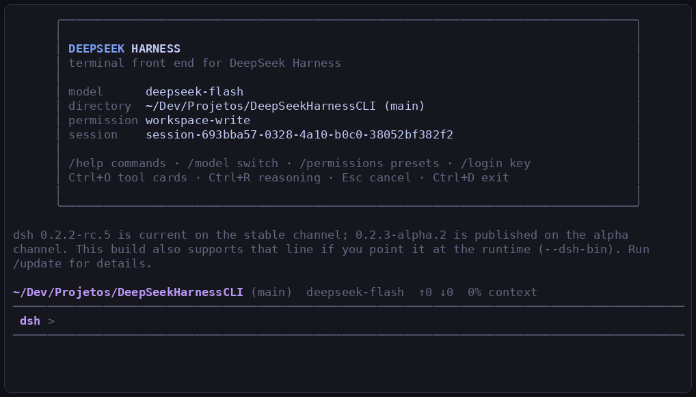

# Compatibilidade com o DeepSeek Harness

O objetivo do projeto é simples: **acompanhar o DSH sem fork**. O CLI não copia o core; ele compõe uma
camada de terminal sobre o `dsh-base` publicado. Este documento descreve o contrato, o que é verificado
automaticamente e o passo a passo para subir a versão suportada.

## Versão suportada

| Item | Valor |
| --- | --- |
| Release do DSH | `0.2.2-rc.5` (dist-tag `next` na época do pin) |
| Tag no repositório upstream | `dsh-v0.2.2-rc.5` |
| Commit | `9c2670d3bce5275e0d1610272958121af87787bb` |
| Faixa aceita pelo bundle (`engines.dsh`) | `^0.2.2-rc.5 \|\| ^0.2.3-alpha.2` |
| Faixa aceita pelo launcher | `^0.2.2-rc.5 \|\| ^0.2.3-alpha.2` |
| Node.js | `>= 24.9.0` |
| Formato de sessão | V4 |
| Canais publicados no npm (23/11/2026) | `latest` = `0.2.2-rc.5` · `alpha` = `0.2.3-alpha.2` |

A faixa aceita duas linhas: a estável `^0.2.2-rc.5` e a pré-release `^0.2.3-alpha.2`. Como no npm, um
pré-release só satisfaz o comparador que nomeia um pré-release da **mesma** `major.minor.patch` — por isso
`0.2.2-rc.6` e `0.2.3-rc.1` entram, mas `0.2.4-alpha.1` e `0.3.0-alpha.1` não. O pin de desenvolvimento
continua na estável; a segunda faixa existe para quem aponta o launcher para um runtime 0.2.3 via
`--dsh-bin`/`DSH_TUI_DSH_BIN`.

## Como o DSH decide se aceita o bundle

O loader do DSH lê `engines.dsh` do pacote do bundle e avalia com semver `includePrerelease`. Se a
instalação não estiver na faixa, o bundle é **ignorado com exit 0** — ele não carrega o arquivo de patch e
segue o boot sem a linha da TUI. É um comportamento correto do DSH, mas péssimo como UX: o processo subiria
sem interface e sem erro.

O `dsh-tui` cobre os dois lados:

1. **O launcher recusa antes de executar** quando o runtime resolvido está fora da faixa, com instrução de
   correção (`--dsh-bin`, `npm i -g @deepseek-ai/dsh@next`).
2. **A guarda de ativação** (`src/startup.ts`) verifica, quando o app fica pronto, se o serviço `tui`
   existe. Se não existir — bundle pulado, import quebrado, linha desativada na camada do usuário — escreve
   a causa no stderr e sai com código 1, em vez de deixar um processo mudo.

## Como saber que o DSH original foi atualizado

O projeto verifica as releases publicadas e mostra o resultado dentro da própria TUI. Não é um `npm
outdated` manual: o aviso aparece sozinho quando há novidade.

- **Ao abrir**: a TUI consulta os dist-tags de `@deepseek-ai/dsh` no npm em segundo plano, **depois** do
  primeiro frame, com timeout de 2,5 s. O resultado fica em `$DSH_HOME/cache/dsh-tui/update-check.json`
  e vale por 24 h — abrir a TUI dez vezes por dia faz uma requisição, não dez.
- **Aviso**: se o `latest` publicado for mais novo que o runtime em execução, o transcript mostra um aviso
  citando as duas versões e o comando de upgrade. Se o runtime já é o `latest` mas existe um `alpha` mais
  novo, aparece uma linha informativa (o alpha não é suportado por esta build).
- **`/update`**: repete a checagem ignorando o cache e imprime o quadro completo (runtime, `latest`,
  `alpha`, horário da consulta, veredito e comando de upgrade).
- **`dsh-tui doctor`**: linha `dsh release` lida do cache (nunca da rede), com `!` quando você está atrás.
- **Desligar**: `--no-update-check`, `updateCheck: false` na config da linha `tui`, ou
  `DSH_TUI_NO_UPDATE_CHECK=1`. Máquina offline não é erro: usa-se a última resposta conhecida, e sem cache
  simplesmente não há aviso.

## Estado do upstream em 23/11/2026 (alpha 0.2.3)

Checagem feita com `git ls-remote`, `npm view` e um boot real:

| Fonte | Resultado |
| --- | --- |
| Tags no GitHub | `dsh-v0.2.3-alpha.1`, `dsh-v0.2.3-alpha.2` (última: 22/11) |
| npm `latest` / `next` | `0.2.2-rc.5` — **é o que o `dsh-tui` 0.2.1 usa** |
| npm `alpha` | `0.2.3-alpha.2` |
| Commits entre `rc.5` e `0.2.3-alpha.2` | 2348 |
| Node exigido pelo upstream alpha | `^24.22.3 \|\| >=26.13.1` (o pin atual pede `>=24.9.0`) |

O que o boot real contra o alpha mostrou:

1. **API mudou**: o Cordis vendorizado subiu para `4.2.0-alpha.1` e `ctx.root` virou acesso por símbolo
   (`ctx[Context.root]`). A versão anterior do bundle morria com
   `cannot get property "root" without inject`.
2. **Piso de Node mais alto**: quem usa Node 26.13.0 (como este ambiente) não satisfaz `>=26.13.1` exigido
   pelo dsh 0.2.3.
3. **Vendor em alpha**: loader/hmr/schemastery também saltaram para alpha na mesma release — é por isso que
   o pin de desenvolvimento não muda junto.

O que a verificação mudou neste projeto:

- **Suporte ao alpha, comprovado por boot real**: a única quebra de API que impedia a TUI de compor era o
  `ctx.root`. O encerramento agora lê `Symbol.for('cordis.root')` e cai para `ctx.root` — o símbolo é
  global, então o mesmo código serve às duas linhas. Com o shim, o profile sobe, desenha o painel e aceita
  input contra `0.2.3-alpha.2` (captura de tela verificada).
- **Faixa dupla** no bundle e no launcher, para que o runtime 0.2.3 não seja recusado.
- **Pin de desenvolvimento mantido na estável**: o alpha traz *vendor* em alpha (loader, hmr, schemastery)
  e piso de Node mais alto; quem quiser testá-lo aponta `--dsh-bin` explicitamente. O `dsh-tui` instala a
  estável por padrão, então ninguém cai no alpha sem querer.
- **Aviso de release**: como o `latest` do npm ainda é `0.2.2-rc.5`, quem está na estável vê apenas a linha
  informativa sobre o alpha; se o upstream promover `0.2.3`, o aviso vira ação (atualizar o `dsh-tui`).

> O alpha também exige Node `^24.22.3 || >=26.13.1` do próprio dsh. O launcher continua aceitando
> `>=24.9.0`; se o runtime recusar o Node, a mensagem vem do dsh, não do `dsh-tui`.

## O que é verificado automaticamente

`pnpm compat` (script `scripts/verify-compat.ts`) falha o build quando:

| Verificação | Motivo |
| --- | --- |
| Submódulo upstream no commit pinado | referência de leitura e de testes |
| `dependencies['@deepseek-ai/dsh']` igual ao pin | launcher instala o runtime certo |
| `engines.dsh` aceita a versão pinada | o loader não vai pular o bundle |
| bundle sem pacotes `@deepseek-ai/*` em `dependencies` | uma cópia dupla de cordis quebraria o core |
| artefato embutido sem `node_modules` | o tarball não deve carregar árvore de dependências |
| todo import `@deepseek-ai/*` declarado em devDeps + peers | typecheck local e resolução no profile |
| patch YAML é um array e todo `name:` de plugin resolve na instalação | plugin renomeado/removido é detectado na hora |
| exports do bundle apontam para arquivos existentes | o profile reescreve para `lib/`, o dev para `src/` |
| `bin.dsh-tui` existe depois do build | pacote publicável |

`pnpm test` cobre as partes puras (faixa semver do launcher, merge de bundles, hash do artefato, tokens,
timing, templates de prompt, defaults de config). `pnpm verify:package` confere o conteúdo exato do tarball
e revalida o hash do bundle embutido.

## Dependências da API pública que o porte usa

Estas são as superfícies que precisam de atenção ao subir de versão. Todas são públicas e estáveis na
linha `0.2.x`; a coluna "risco" indica o que costuma mudar.

| Superfície | Uso | Risco |
| --- | --- | --- |
| `ctx.agents.create/resume` + `AgentHandle` | dono do agente da invocação | médio |
| `agent.followup/steer/inject/cancel/status/model/inbox` | envio e controle de turno | baixo |
| eventos `agent/*` (`inbox/claimed`, `inbox/inserted`, `inbox/discarded`, `status`, `error`, `disposed`, `created`, `assistant-stream`) | toda a reatividade da UI | **alto** (payloads mudam) |
| eventos de sessão (`user/message`, `step/*`, `assistant/message`, `tool/call`, `tool/result`, `turn/*`, `session/title`, `todo/write`, `llm/retry`, `compaction/*`) | reconstrução do transcript | alto |
| `ctx.sessionQuery.readSession/listSessions/readTitleSnapshots/observeSession` | reabrir sessão, títulos, `/resume` | médio |
| `ctx.sessionPersistence.stat` | caminho/mtime para atividade | baixo |
| `ctx.commands.register/execute/list` | comandos e `/skill:` | baixo |
| `ctx.permissionPresets.resolve/set` | `--permission-mode` | baixo |
| `ctx.agentDefaultModel.currentSelection/saveSelection` | `/model` | baixo |
| `ctx.sessionReferenceResolver.prepare/listCandidates` | referências `@sessão` | médio |
| seam `user-questions/request` (waterfall) | `ask_user_question` | médio |
| `ctx.skills.{list,snapshot,get}` | `/skill:<nome>` | baixo |
| `ctx.systemPrompt.section/assemble`, `renderPrompt` | `/status`, prompt de arquivo | baixo |
| `@deepseek-ai/dsh-cmdline` `parseCmdline` | flags da TUI integradas ao `--help` do dsh | baixo |
| `expandedAssistantStream` + `StreamChunk` | streaming durável | médio |

Regras de ouro que o porte já segue e que novos recursos devem manter:

- Não usar `eventAt`, `snapshotEvents`, `ownEvents` (depreciados e proibidos para código novo).
- Não depender de `agent/prompt-submit`, `agent-loop/config-start-failed`, `acceptsNextStep` nem
  `installAgentLlmTarget` (não existem mais).
- Compactação é evento de sessão (`compaction/start|summary|end|prune`), não `compact/*`.
- `ToolResultMessage` não aninha bloco `tool-result`: usar `message.content` + `message.isError`.

## Subindo a versão suportada

Checklist para um bump (ex.: `0.2.2` final ou `0.2.3`):

1. **Atualizar a referência**: `git -C upstream/deepseek-harness fetch --tags && git -C upstream/deepseek-harness checkout dsh-vX.Y.Z`; anotar o commit.
2. **Alterar o pin em três lugares**:
   - `scripts/verify-compat.ts` (`PIN.dshVersion`, `PIN.tag`, `PIN.commit`);
   - `packages/cli/package.json` → `dependencies['@deepseek-ai/dsh']`;
   - `packages/bundle/package.json` → `engines.dsh` (e `packages/cli/scripts/embed-bundle.ts` + `packages/cli/src/launcher/profile.ts` geram o mesmo `engines` no artefato — mantenha os três iguais).
3. **Atualizar os devDeps do bundle** para a mesma versão:
   `pnpm --filter @gblelis/dsh-tui-bundle add -D @deepseek-ai/dsh-agent@X.Y.Z @deepseek-ai/dsh-llm@X.Y.Z …`
   (a lista está no `packages/bundle/package.json`; rode `pnpm install` e confira o lockfile).
4. **`pnpm compat`** — os plugins do patch e os imports são revalidados contra a nova instalação.
5. **`pnpm typecheck`** — cada erro aponta uma mudança de API. Corrija o porte (não use `any`, não
   suprima com `@ts-expect-error` sem comentário de rastreio).
6. **`pnpm test`** — os testes de apresentação pegam mudanças de forma de evento.
7. **`pnpm build && pnpm verify:package`** — re-embute o bundle e valida hash/tarball.
8. **Teste manual**: `DSH_HOME=$(mktemp -d) dsh-tui --dsh-bin <nova instalação>/lib/bin.js doctor` e um
   chat real (streaming, tool call, `/model`, `/resume`, `Ctrl+C`).
9. **Registrar no changelog** a nova faixa e o que mudou no porte.
10. **Atualizar a linha "Canais publicados"** desta tabela (e o exemplo em `docs/providers.md`, se o
    provider padrão mudar).

> Pré-release de outra linha (`0.2.3-alpha.2` contra `^0.2.2-rc.5`) é recusada pelo launcher de propósito,
> mesmo que o número pareça mais novo. Testar um alpha exige mudar o pin numa branch descartável.

Se a mudança for grande (ex.: `0.3`), o caminho é criar a faixa nova no launcher e no bundle
(`^0.3.0`) e manter uma tag antiga do `dsh-tui` para quem estiver no `0.2.x`. O launcher recusar a faixa
antiga é intencional: melhor um erro claro do que uma UI sem metade dos eventos.

## Divergência de runtime

Se o `doctor` apontar um runtime como `outside ^0.2.2-rc.5`, você tem três opções:

1. Instalar o runtime suportado: `npm i -g @deepseek-ai/dsh@0.2.2-rc.5` (ou `@next`, se já for essa).
2. Apontar para uma cópia correta: `dsh-tui --dsh-bin /caminho/lib/bin.js`.
3. Esperar uma release do `dsh-tui` para a versão nova.

O `dsh-tui` **não** força o boot num runtime desconhecido: os eventos e serviços da interface mudam entre
minor versions e a falha apareceria no meio de uma sessão, não no começo.

## Sessões entre versões

O formato V4 é compartilhado por toda a linha `0.2.x`. Uma sessão criada pelo Desktop/Web/CLI abre em
qualquer superfície da mesma linha. Um bump de `dsh-tui` não migra nem reescreve sessões: isso é
responsabilidade do core.
